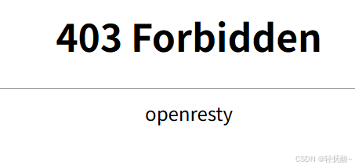
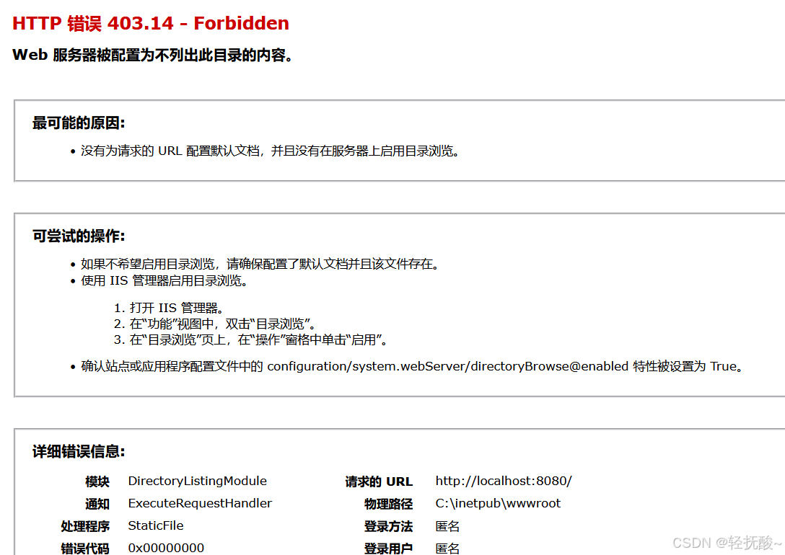
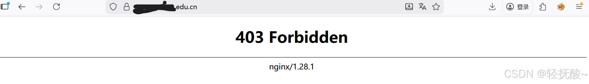

<font color="red">免责声明</font> 本文章所有操作均已得到授权，严禁私自用于任何形式的违法犯罪活动，否则后果自行承担！~~阅读代表同意~~

## 0x00 写在前面
- 网安萌新的学习记录文章，一定有不严谨的地方，欢迎指正！
- 不知道师傅们第一次知道 `403-bypass` 的过程是什么，我是在字典里面漫无目的的时候发现了几个比较出名的字典都有一个单独的 `403.txt` 字典开始知道的。
- 本文先介绍一下理论知识并附带工具推荐，然后是部分实战记录。

## 什么是 403 
> `403 status code`（403状态码）：服务器已经理解请求，但是拒绝执行它。与 401 响应不同的是，身份验证并不能提供任何帮助，而且这个请求也不应该被重复提交。如果这不是一个 `HEAD` 请求，而且服务器希望能够讲清楚为何请求不能被执行，那么就应该在实体内描述拒绝的原因。当然服务器也可以返回一个 404 响应，**假如**它不希望让客户端获得任何信息。

挺好理解的，如果说爆破目录是在墙上找门，那 `404 Not Found` 就是没找到门而 `403 Forbidden` 就是找到了门但是门上锁了，这个锁就是我们需要绕过的。

## 403-Bypass
> 服务器返回 `403` 而非 `404` 说明访问的文件是**存在**的但是不允许你访问（类似鉴权失败），猜测原因并尝试绕过就是 `Bypass` 了。
### 最常见原因：
**1、** 物理资源访问被拒。
> 通常由 Web 服务器如Nginx，apache，tomcat等中间件直接返回的403，应用层代码根本没有被执行。

- 当访问的文件只有root用户可读写的时候，外部用户请求该文件会因权限不足被中间件抛出403
- Web 服务器配置了拒绝访问的正则（例如默认拒绝访问以 `.` 开头的敏感目录像`.git`）

**2、** WAF / CDN / 防火墙拦截
> 当流量经过 WAF 设备时，403 往往代表触发了安全防御规则。这类 403 的响应体（Body）通常会包含 WAF 的拦截页面或特定的 Request ID。

- 访问 IP/地理位置 在黑名单里
- 常见扫描器特征 `UA头` 拦截（如sqlmap，nmap默认的 `UA头`）或者 非标准/为空 的 `UA头` 请求
- 如果请求 URL 参数或者 POST Body 中包含典型的 SQL 注入、XSS 脚本或路径穿越特征，WAF 会直接进行阻断并返回 403

**3、** 应用逻辑/业务/代码级拦截
> 请求成功穿透了中间件和 WAF，到达了后端的业务代码（如 Spring Boot, Django, Node.js），由业务逻辑抛出的 403。

- 用户已登录（校验成功）但是尝试越权操作
- 请求头或表单中缺失（CSRF）token 或者 token 校验不匹配

**4、** 微软 IIS 的 403 细分
> 如果是 Microsoft IIS 服务器，它将 403 错误在协议层面进行了官方细分（通过子状态码），直接依据子状态码去查官方文档或者其他资料就行。

这里列举几个，详情可以看这篇 [blog](https://developer.aliyun.com/article/396315)

```c
403.1 - Execute access forbidden：尝试执行一个没有执行权限的脚本（例如在一个纯静态目录里运行 CGI 或 ASPX）。

403.3 - Write access forbidden：尝试对不支持 PUT 方法的目录进行写入，或文件系统级禁止写入。

403.4 - SSL required：网站配置了强制 HTTPS，但客户端使用 HTTP 发起请求（现代架构多用 301 重定向处理，但严格配置下会直接 403）。

403.6 - IP address rejected：IIS 级别的 IP 限制规则生效。

403.14 - Directory listing denied：拒绝目录列表
```

## 403-Bypass姿势-FUZZ
### 请求方法
```a
GET
POST
PUT
DELETE
CONNECT
OPTIONS
TRACE
PATCH
INVENTED
HACK
HEAD
```
### 请求头
#### 伪造来源（ip、域名、路径）
```c
标准头：
# 1、Host删除（将HTTP协议从1.1换成1.0，1.0不存在Host头）
# 2、Host双写（写在原Host头下方）
# 3、Host修改
Host: 127.0.0.1/子域名-遍历
Referer: (子)域名-路径
X-Originating-IP: 127.0.0.1
X-Forwarded-For: 127.0.0.1
X-Forwared-Host: 127.0.0.1

自定义头：
X-Real-IP: 127.0.0.1
X-Real-Addr: 127.0.0.1
X-Remote-IP: 127.0.0.1
X-Remote-Addr: 127.0.0.1
X-Client-IP: 127.0.0.1
X-Client-Addr: 127.0.0.1
X-ProxyUser-Ip: 127.0.0.1
X-ProxyUser-Addr: 127.0.0.1
X-Original-URL: 127.0.0.1
X-Host: 127.0.0.1
X-Custom-IP-Authorization: 127.0.0.1
Client-IP: 127.0.0.1
True-Client-IP: 127.0.0.1
X-Forwarded: 127.0.0.1
Forwarded-For: 127.0.0.1
```

### 路径
> 如果你访问 `/admin` 路径出现 403 那么可以尝试 FUZZ ⬇️
> 其他路径也是类似的等效替换。
```a
/admin/?
//admin//
///admin///
/./admin/./
/admin?
/admin??
/admin??
/admin/?/
/admin/??
/admin/??/
/admin/..
/admin/../
/admin/./
/admin/.
/admin/.//
/admin/*
/admin//*
/admin/%2f
/admin/%2f/
/admin/%20
/admin/%20/
/admin/%09
/admin/%09/
/admin/%0a
/admin/%0a/
/admin/%0d
/admin/%0d/
/admin/%25
/admin/%25/
/admin/%23
/admin/%23/
/admin/%26
/admin/%3f
/admin/%3f/
/admin/%26/
/admin/#
/admin/#/
/admin/#/./
/./admin
/./admin/
/..;/admin
/..;/admin/
/.;/admin
/.;/admin/
/;/admin
/;/admin/
//;//admin
//;//admin/
/admin/./
/%2e/admin
/%2e/admin/
/%20/admin/%20
/%20/admin/%20/
/admin/..;/
/admin.json
/admin/.json
/admin..;/
/admin;/
/admin%00
/admin.css
/admin.html
/admin?id=1
/admin~
/admin/~
/admin/°/
/admin/&
/admin/-
/admin\/\/
/admin/..%3B/
/admin/;%2f..%2f..%2f
/ADMIN
/ADMIN/
/admin/..\;/
/*/admin
/*/admin/
/ADM+IN
```

## 相关工具
1. https://github.com/lobuhi/byp4xx
2. https://github.com/iamj0ker/bypass-403
3. https://github.com/gotr00t0day/forbiddenpass
4. Burp插件:https://portswigger.net/bappstore/444407b96d9c4de0adb7aed89e826122
## 部分实操

1、 `403` 的作用还挺多，比如作为边缘资产泄露目标所用系统。
- 比如就是 `IIS` 返回的 `403` 报错，那么后端大概率 `windows + IIS + c# + SQL Server` 一条龙。


- 再比如一个网址根目录 `403` 然后用字典 FUZZ 目录，从泄露的文件发现是 `Moodle` ——出名的开源的在线学习管理系统（中文名魔灯），然后访问 `/pix/moodlelogo.png`路径发现确实有 logo 出来那么就大体可以确定其他活着的资产也是用的魔灯系统




___
后续**可能**会更新更多实操内容或者修改前面不对的地方~
___

（如有不恰当的地方欢迎指正哦 ~o(●'◡'●)o）

**<font color="red">参考blogs：</font>**
【[完整教程：渗透技巧403绕过](https://www.cnblogs.com/wzzkaifa/p/19122524)】
【[IIS 403错误详细原因](https://developer.aliyun.com/article/396315)】