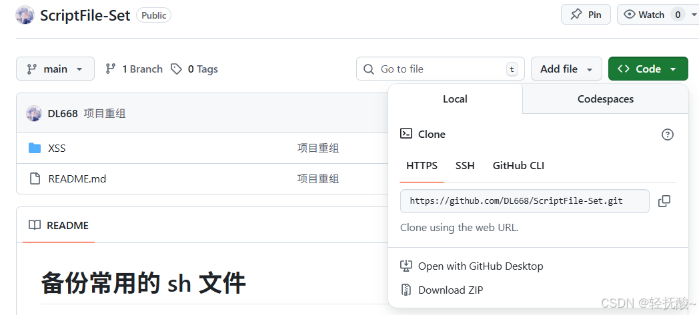
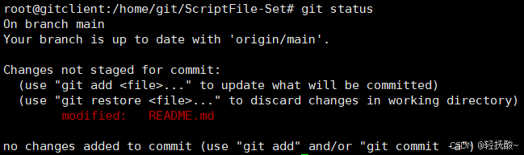
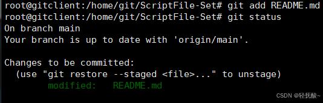
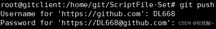
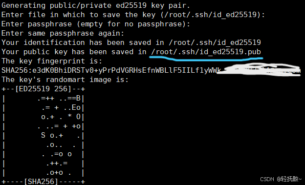
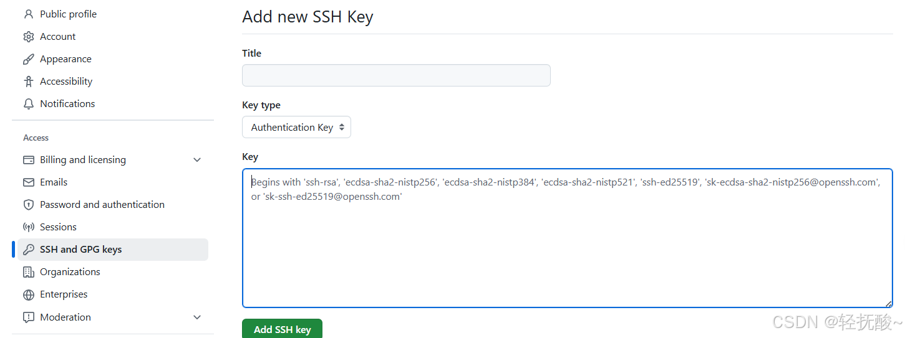

# 前言
&nbsp;&nbsp;&nbsp;&nbsp;记录一下基于 `git` 的简单 github项目的维护和管理，保存学习到的命令和知识点防止后续遗忘。

> 下面开始实践操作，一些命令涉及到的知识点会在用到命令的时候额外说明。

# 实践
<font color="green">其实就两步：克隆项目到本地进行维护，将修改维护的更改提交到 github 上。</font>
1. **克隆项目**
找一个自己需要修改的项目点击项目右上角绿色按钮复制 `https` 协议的项目地址。

使用 clone 克隆项目到本地电脑：
```sh
# 克隆到本地
git clone https://github.com/DL668/ScriptFile-Set.git
# 进入项目进行维护
cd ScriptFile-Set
```
> 一：git 的一大功能就是克隆，这不需要设置账号密码，ssh密钥那些，只是作为一个游客访问下载 github上的仓库到本地。
> 二： 如果已经 clone 到本地了那么就好习惯在项目目录下 `git pull` 一下，拉取项目最新代码防止后续 `push` 的时候冲突。


~~<font size3>项目的维护修改就不用说了</font>~~
2. 提交修改
```sh
# 1. 告诉 git 你修改了哪些文件，一个点是所有，也可以一个文件一个文件push
git add . 

# 2. 可以查看当前仓库的状态，会显示修改的信息具体如下图
git status

# 3. “结账”，把修改正式记录下来（需要设置git的用户名和邮箱）
# ----
git config --global user.name "用户名"
# 设置成 github 上的邮箱那么你提交其他人的项目的时候github会自动关联你的账号让别人知道是你提交的，没这需要就无所谓
git config --global user.email "你的邮箱地址"
git commit -m "这里写你干了啥，比如：更新了README文档"
# ----
```

修改代码后如图（会标识出没有add的修改文件/夹）：

add 后如图（变绿）：



3. 推送到github
```sh
git push
```
如果是直接 `push` 的话每次都需要填写github的账号密码，为了方便一般都会采用ssh密钥丝滑提交。

# git 设置 ssh密钥
1. 在本地设置 ssh密钥
```sh
# 一直回车就行
# ed25519 是目前最安全且快速的算法，如果旧系统不支持，可以用 -t rsa -b 4096
ssh-keygen -t ed25519 -C "你的GitHub邮箱@example.com"
```


2. 将公钥复制到 github 上，给这个公钥取个名字然后保存即可

3. 丝滑push
```sh
# 1、测试连接
ssh -T git@github.com
# 2、查看默认的协议（HTTPS）
git remote -v
# 3、修改默认的协议为 SSH
# ssh key：可以直接复制项目的ssh key，点击右上角绿色按钮code后点击ssh复制链接
git remote set-url origin git@github.com:你的用户名/项目名称.git
#  4、push
git push
```
> 配置完 ssh密钥后，由于是保存在电脑本地的那么就算是自己的 private 项目也可以直接clone下来（但是链接得是ssh协议的，这样才会自动去找私钥完成鉴权），不用麻烦地输入账密。
> 注：需要注意私钥不要被泄露了，可以搜搜掌管私钥的软件/项目。